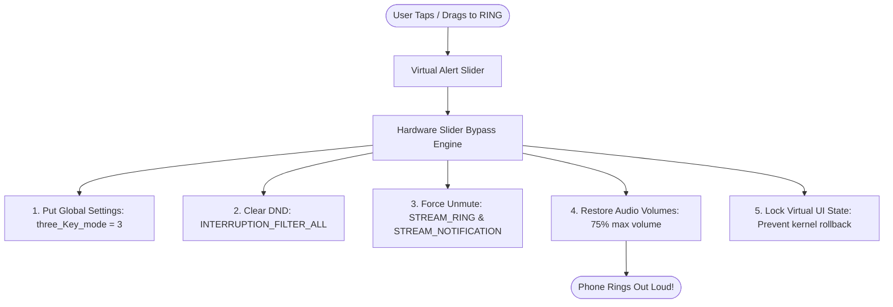

# 🎚️ Virtual Alert Slider

[](https://github.com/shaiiiikh-github/VirtualAlertSlider/releases/latest)
[](https://android.com)
[](https://kotlinlang.org)
[](https://developer.android.com/jetpack/compose)
[]()

> **"Your physical alert slider, accessible digitally anywhere, anytime."**

**Virtual Alert Slider** is a modern, production-grade Android utility engineered to provide a complete software-driven replacement and bypass for physical alert sliders. Whether your phone's physical alert slider is **jammed with pocket lint, mechanically broken, stuck permanently on Silent, or missing entirely** (such as on Samsung, Google Pixel, or Xiaomi devices), this app restores complete, independent control over your phone's sound profiles.

---

## 🎯 Problem Statement

On smartphones equipped with a physical hardware alert slider (such as OnePlus):
1. **The Stuck Slider Dilemma:** With regular use, pocket debris and mechanical wear often cause the physical slider switch to get jammed in the **SILENT** notch.
2. **The Kernel Hardware Lock:** In OxygenOS and custom Android vendor kernels, a physical switch in the Silent position locks the audio driver. Standard volume buttons cannot restore the ringer because the operating system kernel immediately resets the volume to zero.
3. **Expensive Repairs:** Replacing a damaged physical slider switch requires motherboard disassembly and service center costs ranging from ₹2,000 to ₹4,000 ($30–$50).
4. **Devices Without Alert Sliders:** Millions of Android users on Google Pixel, Samsung Galaxy, and Motorola devices lack a fast, tactile 3-stage sound switcher.

**Virtual Alert Slider overcomes all these hurdles purely through software.**

---

## 🚀 Key Features

* 🔔 **Full Ring Mode**: Restores `RINGER_MODE_NORMAL`, unmutes `STREAM_RING` and `STREAM_NOTIFICATION`, and clears Do Not Disturb policies.
* 📳 **Tactile Vibrate Mode**: Sets `RINGER_MODE_VIBRATE` for silent environments while retaining haptic call awareness.
* 🔇 **Silent Mode (DND)**: Intelligently configures Do Not Disturb policies (`INTERRUPTION_FILTER_ALARMS`) so crucial morning alarms still ring while silencing distracting calls and alerts.
* 🛠️ **Hardware Slider Bypass Engine**: Actively overrides jammed hardware switches by unmuting audio streams and prioritizing user on-screen selection over stuck kernel broadcasts.
* 🎚️ **Fluid Vertical Slider UI**: Built with Jetpack Compose featuring spring animations, draggable knob physics, tap-to-snap points, and custom haptic feedback.
* 📱 **Material 3 Desktop Widget**: Interactive `AppWidgetProvider` widget placed on your home screen for instant 1-tap mode toggling.
* ⚡ **Quick Settings Tile**: Integrated Android `TileService` allowing you to flip ringer profiles directly from the notification shade without launching the app.
* ⚙️ **Persistent Preferences**: Uses Jetpack DataStore to remember your startup defaults, haptic preferences, theme choice, and bypass settings.
* 🎨 **Dark Slate / Obsidian Theme**: Tailored Material 3 palette with mode-specific vibrant accents (Ring Blue, Vibrate Amber, Silent Pink).

---

## 📥 Download & Installation

You can download the pre-compiled APK directly onto your phone without needing Android Studio:

👉 **[Download Latest APK from GitHub Releases](https://github.com/shaiiiikh-github/VirtualAlertSlider/releases/latest)**

1. Download **`VirtualAlertSlider-v1.2.0.apk`** to your Android phone.
2. Tap the downloaded file to install.
3. If prompted, allow *"Install from this source"*.
4. Open the app and grant **Do Not Disturb (Notification Policy) Access** when prompted.

---

## 🏗️ Architecture & Project Structure

The project follows the official **Clean Architecture + MVVM** guidelines:

```text
com.virtualalertslider.app/
├── data/
│   ├── preferences/
│   │   └── PreferencesManager.kt          # Jetpack DataStore preferences
│   └── repository/
│       ├── AlertSliderRepository.kt        # Repository abstraction
│       └── AlertSliderRepositoryImpl.kt    # Hybrid state stream (Hardware + User Override)
├── domain/
│   ├── model/
│   │   ├── AlertMode.kt                    # RING, VIBRATE, SILENT definitions
│   │   ├── SliderSettings.kt               # Settings domain model
│   │   └── ThemePreference.kt              # SYSTEM, LIGHT, DARK
│   └── usecase/
│       ├── GetAlertModeUseCase.kt
│       ├── SetAlertModeUseCase.kt
│       ├── ObserveAlertModeUseCase.kt
│       ├── GetSettingsUseCase.kt
│       └── SaveSettingsUseCase.kt
├── system/
│   ├── AudioModeManager.kt                 # Stream unmuting & hardware bypass logic
│   ├── NotificationPolicyManager.kt        # DND permission checking & intents
│   └── RingerModeReceiver.kt               # Listens for system ringer & DND changes
├── tile/
│   └── VirtualAlertSliderTile.kt           # Quick Settings TileService implementation
├── widget/
│   └── VirtualAlertSliderWidget.kt         # Desktop Home Screen Widget
└── ui/
    ├── components/
    │   ├── VerticalAlertSlider.kt          # Compose vertical slider with drag & tap
    │   ├── AlertModeCard.kt                # Active mode showcase card
    │   ├── HeaderCard.kt                   # App header and permission indicator
    │   └── PermissionBanner.kt             # DND permission alert card
    ├── screens/
    │   ├── main/
    │   │   ├── MainScreen.kt               # Main slider and mode selector UI
    │   │   └── MainViewModel.kt            # StateFlow UI state holder
    │   └── settings/
    │       ├── SettingsScreen.kt           # Bypass switch, haptics & theme preferences
    │       └── SettingsViewModel.kt        # Settings management ViewModel
    └── theme/
        ├── Color.kt                        # Slate and mode accent tokens
        ├── Theme.kt                        # Material 3 dynamic color theme
        └── Type.kt                         # Typography definitions
```

---

## ⚙️ How the Hardware Bypass Works

When a physical switch is jammed in Silent, Android's kernel blocks standard ringer switches. Virtual Alert Slider overcomes this via a 3-layer approach:



### Optional Deep OnePlus System Hook (ADB)
For complete system-level integration on OxygenOS devices, users can optionally grant the protected secure settings permission via ADB:

```bash
adb shell pm grant com.virtualalertslider.app android.permission.WRITE_SECURE_SETTINGS
```
This enables the app to write directly to OxygenOS's internal `three_Key_mode` system table, instructing the OS kernel to recognize the phone in Ring mode despite a jammed physical switch.

---

## 🛠️ Build & Developer Setup

### Prerequisites
* **Android Studio**: Ladybug / Koala / Hedgehog or newer
* **JDK**: OpenJDK 17 or higher
* **Android SDK**: API Level 35 (Android 15)

### Building from Source

```bash
# Clone the repository
git clone https://github.com/shaiiiikh-github/VirtualAlertSlider.git
cd VirtualAlertSlider

# Run automated unit tests
./gradlew test

# Build debug APK
./gradlew assembleDebug
```

The output APK will be generated at:
`app/build/outputs/apk/debug/app-debug.apk`

---

## 🧪 Unit Tests

Automated unit tests are located in `app/src/test`:
* **`AlertModeTest.kt`**: Tests mode indexing, cycling (`RING` -> `VIBRATE` -> `SILENT`), and ringer mode translations.
* **`SetAlertModeUseCaseTest.kt`**: Tests clean architecture use cases, repository dispatch, and permission handling.

To run tests:
```bash
./gradlew test
```

---

## 📄 License

This project is licensed under the Apache License 2.0. Open-source Android utility built with standard Android Open Source Project (AOSP) APIs with zero vendor lock-in.
